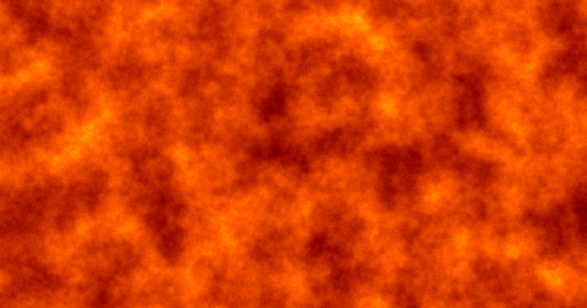
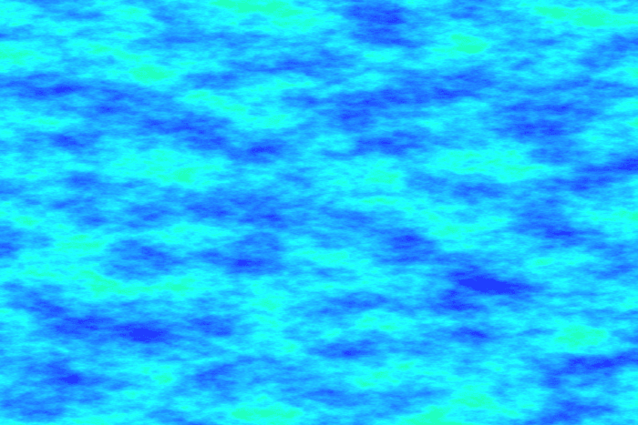
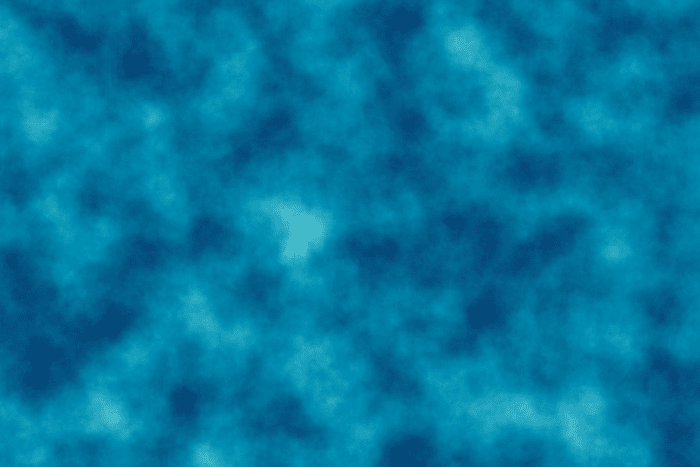
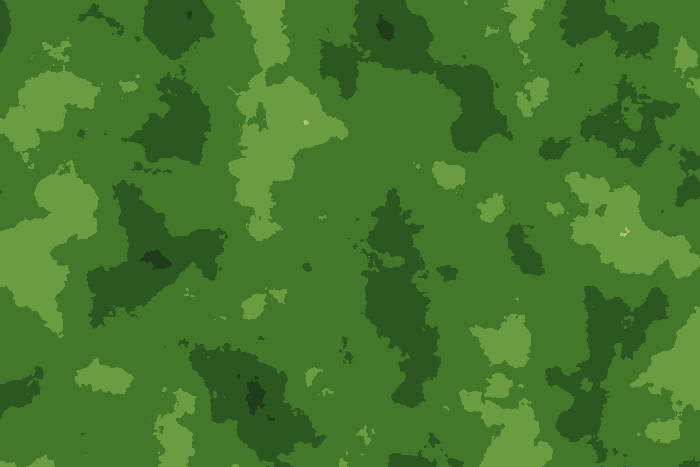
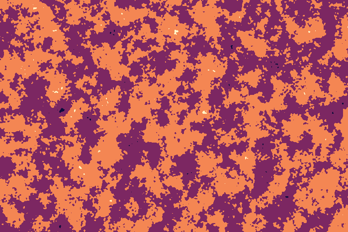

# Perlin Studio

> Parametric 3D/4D Perlin animations in the browser — worker-accelerated,
> WebM export, seamless loop. Fully client-side, no dependencies, no build.

[](LICENSE)
[](#quickstart)
[](#)
[](#browser-compatibility)

<p align="center">
  <a href="https://jkaindl.codeberg.page/perlin-studio/">
    
  </a>
</p>

<p align="center">
  <a href="https://jkaindl.codeberg.page/perlin-studio/">
    
  </a>
</p>

Grown out of two older hobby projects (`_archiv/texturizer.ipynb` from
early 2023 + `_archiv/perlin_noise/` from May 2023) into a focused
browser tool. Designed for static hosting, embedding on a homepage, and
as the basis for an Obsidian plugin.

---

## Quickstart

```bash
# Variant A — just double-click
open index.html       # macOS
start index.html      # Windows
xdg-open index.html   # Linux

# Variant B — local server (handy for hot-reload during development)
python3 -m http.server 8000
# → http://localhost:8000
```

Hit **▶** or **Space**, click a preset chip, or move any slider — the
live preview updates after every input.

## What it does

- **Live preview** of parametric Perlin animations (fBm with octaves,
  persistence, lacunarity, seed)
- **Four color modes**: RGB (per channel), Gradient (8 presets), HSV,
  Posterize
- **Seamless loop** — 4D Perlin on a circular path in `(z, w)`, closes
  mathematically without any "breathing" artifact
- **WebM export** at arbitrary length/framerate via `MediaRecorder`
- **PNG snapshot** of the current frame
- **Preset system** with 6 built-ins and JSON import/export
- **Worker-accelerated** — main thread stays free, frame-skip without
  drift, wall-clock time as animation basis

## Gallery

All four images were rendered with the tool itself — a single frame
from the 4D loop in each case. Reproducible via seed (`base`) + parameters.

<table>
  <tr>
    <td width="50%"></td>
    <td width="50%"></td>
  </tr>
  <tr>
    <td align="center"><sub><b>Aurora</b> · HSV mode, scaleY ≫ scaleX → horizontal bands</sub></td>
    <td align="center"><sub><b>Ocean</b> · gradient, 6 octaves for soft organic flow</sub></td>
  </tr>
  <tr>
    <td width="50%"></td>
    <td width="50%"></td>
  </tr>
  <tr>
    <td align="center"><sub><b>Terrain</b> · Posterize mode with 7 steps → contour-map look</sub></td>
    <td align="center"><sub><b>Circuit</b> · Posterize 4-step, high lacunarity → hard edges</sub></td>
  </tr>
</table>

## Live loops

Three seamless 2.5-second loops, rendered by the tool itself — source and
parameters in [`scripts/render-readme-videos.js`](scripts/render-readme-videos.js).
The WebMs live under [`docs/examples/`](docs/examples/) and are directly
linkable from the [live demo](https://jkaindl.codeberg.page/perlin-studio/)
(handy for embedding into other docs).

<table>
  <tr>
    <td width="33%"><video src="https://jkaindl.codeberg.page/perlin-studio/docs/examples/lava-loop.webm" autoplay loop muted playsinline width="100%"></video></td>
    <td width="33%"><video src="https://jkaindl.codeberg.page/perlin-studio/docs/examples/aurora-loop.webm" autoplay loop muted playsinline width="100%"></video></td>
    <td width="33%"><video src="https://jkaindl.codeberg.page/perlin-studio/docs/examples/terrain-loop.webm" autoplay loop muted playsinline width="100%"></video></td>
  </tr>
  <tr>
    <td align="center"><sub><b>Lava</b> · Fire gradient · 5 octaves</sub></td>
    <td align="center"><sub><b>Aurora</b> · HSV mode · strongly anisotropic scale</sub></td>
    <td align="center"><sub><b>Terrain</b> · Posterize 7-step · Forest gradient</sub></td>
  </tr>
</table>

## Usage

Full reference of every parameter and control:
**[docs/USAGE.md](docs/USAGE.md)**.

Short version of the most important controls:

| Element | Function |
|---------|----------|
| Left sidebar | All parameters (resolution, noise, loop, color, presets, export) |
| Large canvas | Live preview (always matches the current slider/input state) |
| **▶ / Space** | Play / pause |
| **⏮** | Slider back to 0 |
| **t slider** | Time scrub (loop: `[0, 1)`, otherwise free) |
| **fps / frames** | Only used for WebM export |

## Architecture in one picture

```
Main thread (UI)              Web Worker
┌─────────────────┐           ┌────────────────┐
│ RAF loop        │ params/t  │ makePermutation│
│ gatherParams()  │──────────▶│ fbm3/fbm4      │
│                 │           │ colorize()     │
│ putImageData    │ ImageData │                │
│ (zero-copy)     │◀──────────│ postMessage    │
│                 │           │  (transferable)│
└─────────────────┘           └────────────────┘
```

Full technical docs (math, pipeline, edge cases):
**[docs/ARCHITECTURE.md](docs/ARCHITECTURE.md)**.

## Browser compatibility

| Browser | Status |
|---------|--------|
| Chrome / Edge (Chromium) ≥ 90 | ✅ full incl. worker + VP9 WebM |
| Firefox ≥ 90 | ✅ full, WebM via VP8 |
| Safari ≥ 14 | ✅ live preview; WebM export works; some versions block the worker under `file://` → falls back to main thread |
| Mobile Safari / Chrome Mobile | ✅ live preview; export may require a longer touch gesture |

The app is responsive and works on mobile — the worker path keeps the
animation smooth even at low resolutions.

## Project layout

```
.
├── index.html             # UI markup
├── styles.css             # theme (dark + light auto via prefers-color-scheme)
├── perlin.js              # math/API (3D + 4D noise, color modes, worker source)
├── perlin-studio.js       # controller (RAF loop, recording, presets, events)
├── manifest.webmanifest   # PWA manifest (installable)
├── assets/                # static assets (favicon, PWA icons, README images)
├── docs/
│   ├── ARCHITECTURE.md    # technical docs
│   ├── USAGE.md           # full user guide
│   └── examples/          # rendered WebM loops (for README + embedding)
├── scripts/
│   ├── render-readme-images.js  # renders assets/*.png from perlin.js
│   └── render-readme-videos.js  # renders docs/examples/*.webm (Node → ffmpeg)
├── _archiv/               # historical predecessors (READ-ONLY)
│   ├── perlin_noise/      # Python original
│   ├── texturizer.ipynb   # Texturizer notebook
│   └── old_texturizer_combined/   # first browser version, incl. Texturizer
├── LICENSE                # AGPL-3.0
├── CHANGELOG.md
├── CONTRIBUTING.md
├── SECURITY.md            # threat model + reporting
└── AGENTS.md              # context file for AI assistants
```

## Contributing

Issues and PRs welcome. Developer quickstart:
**[CONTRIBUTING.md](CONTRIBUTING.md)**.

Security-related reports — please don't file them publicly. See
**[SECURITY.md](SECURITY.md)**.

AI assistants (Claude Code, etc.) get their orientation in
**[AGENTS.md](AGENTS.md)**.

## Roadmap

- [ ] **Gradient editor** — define custom color stops instead of presets only
- [ ] **Tileable noise** — `repeatx`/`repeaty`/`repeatz` like in the Python
  library, for seamlessly tileable textures
- [ ] **GIF export** as alternative to WebM (`gif.js`, ~12 KB)
- [ ] **Obsidian plugin** — `main.ts` with a modal + canvas embed
- [ ] **Web Component** — embeddable `<perlin-studio>` variant for the homepage

## License

[GNU AGPL-3.0](LICENSE) — copyleft with the network-use clause. If you
host the tool (or a fork) so others can use it over the network, the
source of your variant must also be available under AGPL.

The Perlin permutation table and the "Improved Noise" algorithm come
from Ken Perlin's freely published Java reference (2002), reimplemented
here in JS.
