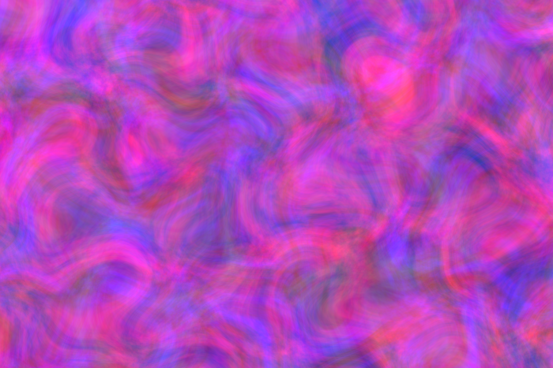
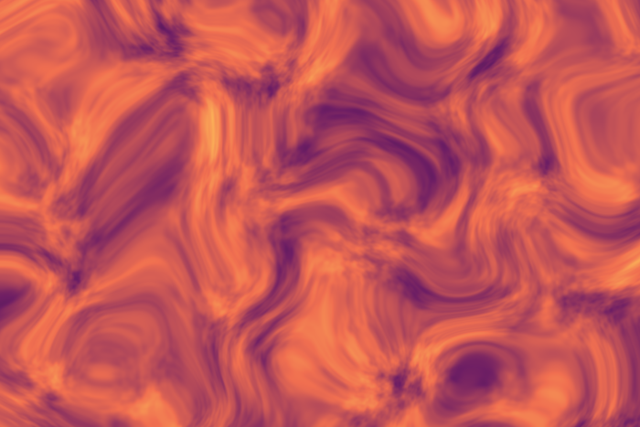
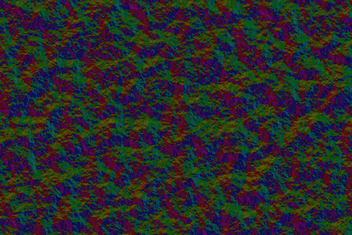
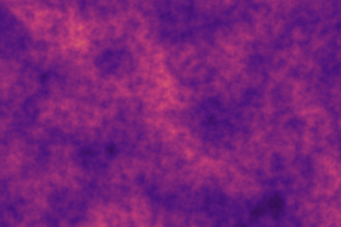

# Perlin Studio

> Parametric 3D/4D Perlin animations in the browser — worker-accelerated,
> WebM export, seamless loop. Fully client-side, no dependencies, no build.

[](LICENSE)
[](#quickstart)
[](#)
[](#browser-compatibility)

<p align="center">
  <a href="https://jkaindl.codeberg.page/perlin-studio/">
    
  </a>
  &nbsp;
  <a href="https://jkaindl.codeberg.page/perlin-studio/examples/embed.html">
    
  </a>
</p>

<p align="center">
  <a href="https://jkaindl.codeberg.page/perlin-studio/">
    
  </a>
</p>

Grown out of two older hobby projects (`_archiv/texturizer.ipynb` from
early 2023 + `_archiv/perlin_noise/` from May 2023) into a focused
browser tool. Designed for static hosting, embedding on a homepage, and
as the basis for an Obsidian plugin.

---

## Quickstart

```bash
# Variant A — just double-click
open index.html       # macOS
start index.html      # Windows
xdg-open index.html   # Linux

# Variant B — local server (handy for hot-reload during development)
python3 -m http.server 8000
# → http://localhost:8000
```

Hit **▶** or **Space**, click a preset chip, or move any slider — the
live preview updates after every input.

## What it does

- **Live preview** of parametric Perlin animations (fBm with octaves,
  persistence, lacunarity, seed)
- **Five color modes**: RGB (per channel, with optional per-channel
  multi-sample for nebula / film-grain looks), Gradient (8 presets +
  custom stops editor), HSV, Posterize, Flow (renders the noise as a
  vector field — hue = local gradient direction)
- **Domain warping** — pre-displaces the sample point by a smoother
  noise field. Switches Perlin output from "Perlin" to marble veins,
  ink in water, alien terrain
- **Layer compositing** — a second noise field can be blended on top
  of the main one with multiply / add / screen / darken / lighten /
  difference modes and a mix slider
- **Image mask** — load a PNG / JPG and use its alpha (or luminance
  as fallback) as a per-pixel mask. PNG export keeps the
  transparency
- **Tileable** — `Tile X` / `Tile Y` make the noise wrap modulo a
  configurable cell period, so the output repeats seamlessly as a
  background texture
- **Seamless loop** — 4D Perlin on a circular path in `(z, w)`, closes
  mathematically without any "breathing" artifact
- **WebM export** at arbitrary length/framerate via `MediaRecorder`
- **PNG snapshot** of the current frame
- **Preset system** with 10 built-ins (default, lava, aurora, clouds,
  terrain, circuit, marble, nebula, flow, composite) and JSON import
  / export
- **Worker-accelerated** — main thread stays free, frame-skip without
  drift, wall-clock time as animation basis
- **Dark + light theme**, follows the OS by default; a sun/moon toggle
  in the topbar pins an explicit choice across reloads

## Gallery

Every image is a single frame from a **built-in preset**, rendered by the tool
itself — and reproducible from the presets via
[`scripts/render-readme-images.js`](scripts/render-readme-images.js). Together
they show the range of colour modes and features.

<table>
  <tr>
    <td width="33%"></td>
    <td width="33%"></td>
    <td width="33%"></td>
  </tr>
  <tr>
    <td align="center"><sub><b>Aurora</b> · HSV mode</sub></td>
    <td align="center"><sub><b>Nebula</b> · per-channel RGB noise</sub></td>
    <td align="center"><sub><b>Marble</b> · domain warp</sub></td>
  </tr>
  <tr>
    <td width="33%"></td>
    <td width="33%"></td>
    <td width="33%"></td>
  </tr>
  <tr>
    <td align="center"><sub><b>Flow</b> · flow field</sub></td>
    <td align="center"><sub><b>Composite</b> · Layer 2 blend</sub></td>
    <td align="center"><sub><b>Terrain</b> · Posterize mode</sub></td>
  </tr>
</table>

## Live loops

Three seamless 2.5-second loops, rendered by the tool itself — source and
parameters in [`scripts/render-readme-videos.js`](scripts/render-readme-videos.js).
The WebMs live under [`docs/examples/`](docs/examples/) and are directly
linkable from the [live demo](https://jkaindl.codeberg.page/perlin-studio/)
(handy for embedding into other docs).

<table>
  <tr>
    <td width="33%"><video src="https://jkaindl.codeberg.page/perlin-studio/docs/examples/lava-loop.webm" autoplay loop muted playsinline width="100%"></video></td>
    <td width="33%"><video src="https://jkaindl.codeberg.page/perlin-studio/docs/examples/aurora-loop.webm" autoplay loop muted playsinline width="100%"></video></td>
    <td width="33%"><video src="https://jkaindl.codeberg.page/perlin-studio/docs/examples/terrain-loop.webm" autoplay loop muted playsinline width="100%"></video></td>
  </tr>
  <tr>
    <td align="center"><sub><b>Lava</b> · Fire gradient · 5 octaves</sub></td>
    <td align="center"><sub><b>Aurora</b> · HSV mode · strongly anisotropic scale</sub></td>
    <td align="center"><sub><b>Terrain</b> · Posterize 7-step · Forest gradient</sub></td>
  </tr>
</table>

## Usage

Full reference of every parameter and control:
**[docs/USAGE.md](docs/USAGE.md)**.

Short version of the most important controls:

| Element | Function |
|---------|----------|
| Left sidebar | All parameters (resolution, noise, loop, color, presets, export) |
| Large canvas | Live preview (always matches the current slider/input state) |
| **▶ / Space** | Play / pause |
| **⏮** | Slider back to 0 |
| **t slider** | Time scrub (loop: `[0, 1)`, otherwise free) |
| **fps / frames** | Only used for WebM export |

## Embedding

Drop the looping animation onto any page with the `<perlin-noise>` custom
element — renderer only, no controls:

```html
<script src="perlin.js"></script>
<script src="perlin-presets.js"></script>
<script src="perlin-engine.js"></script>
<script src="perlin-element.js"></script>

<perlin-noise preset="aurora" autoplay></perlin-noise>
```

Configure it with a built-in `preset` name, a `src` pointing at a preset
JSON exported from the studio, or the `params` JS property. It fills its
container responsively (render resolution capped via `max-resolution`,
default 1280), respects `prefers-reduced-motion`, and pauses while
off-screen. Works from `file://` too — except `src`, which needs an HTTP
server (use `preset` or `.params` locally).

▶ **See it live:** [jkaindl.codeberg.page/perlin-studio/examples/embed.html](https://jkaindl.codeberg.page/perlin-studio/examples/embed.html)
— source in [examples/embed.html](examples/embed.html).

## Architecture in one picture

```
Main thread (UI)              Web Worker
┌─────────────────┐           ┌────────────────┐
│ RAF loop        │ params/t  │ makePermutation│
│ gatherParams()  │──────────▶│ fbm3/fbm4      │
│                 │           │ colorize()     │
│ putImageData    │ ImageData │                │
│ (zero-copy)     │◀──────────│ postMessage    │
│                 │           │  (transferable)│
└─────────────────┘           └────────────────┘
```

Full technical docs (math, pipeline, edge cases):
**[docs/ARCHITECTURE.md](docs/ARCHITECTURE.md)**.

## Browser compatibility

| Browser | Status |
|---------|--------|
| Chrome / Edge (Chromium) ≥ 90 | ✅ full incl. worker + VP9 WebM |
| Firefox ≥ 90 | ✅ full, WebM via VP8 |
| Safari ≥ 14 | ✅ live preview; WebM export works; some versions block the worker under `file://` → falls back to main thread |
| Mobile Safari / Chrome Mobile | ✅ live preview; export may require a longer touch gesture |

The app is responsive and works on mobile — the worker path keeps the
animation smooth even at low resolutions.

## Project layout

```
.
├── index.html             # UI markup
├── styles.css             # theme (dark + light, system-following with topbar toggle override)
├── perlin.js              # math/API (3D + 4D noise, color modes, worker source)
├── perlin-presets.js      # gradients, built-in presets, resolveParams (shared)
├── perlin-engine.js       # headless render engine (worker + RAF loop)
├── perlin-studio.js       # controller (UI, recording, presets, events)
├── perlin-element.js      # <perlin-noise> embeddable custom element
├── manifest.webmanifest   # PWA manifest (installable)
├── assets/                # static assets (favicon, PWA icons, README images)
├── examples/
│   └── embed.html         # <perlin-noise> embedding demo
├── docs/
│   ├── ARCHITECTURE.md    # technical docs
│   ├── USAGE.md           # full user guide
│   └── examples/          # rendered WebM loops (for README + embedding)
├── scripts/
│   ├── render-readme-images.js  # renders assets/*.png from perlin.js
│   └── render-readme-videos.js  # renders docs/examples/*.webm (Node → ffmpeg)
├── _archiv/               # historical predecessors (READ-ONLY)
│   ├── perlin_noise/      # Python original
│   ├── texturizer.ipynb   # Texturizer notebook
│   └── old_texturizer_combined/   # first browser version, incl. Texturizer
├── LICENSE                # AGPL-3.0
├── CHANGELOG.md
├── CONTRIBUTING.md
├── SECURITY.md            # threat model + reporting
└── AGENTS.md              # context file for AI assistants
```

## Contributing

Issues and PRs welcome. Developer quickstart:
**[CONTRIBUTING.md](CONTRIBUTING.md)**.

Security-related reports — please don't file them publicly. See
**[SECURITY.md](SECURITY.md)**.

AI assistants (Claude Code, etc.) get their orientation in
**[AGENTS.md](AGENTS.md)**.

## Roadmap

Shipped since the original list:

- [x] **Gradient editor** — custom color stops (since v0.8.0)
- [x] **Domain warping** — Inigo-Quilez-style sample-point displacement (v0.8.0)
- [x] **Per-channel noise** for RGB mode (v0.9.0)
- [x] **Flow-field colour mode** — render the noise as a vector field (v0.9.0)
- [x] **Tileable noise** — `Tile X` / `Tile Y` make the output repeat (v0.10.0)
- [x] **Image mask** — load a PNG / JPG, render noise inside the alpha (v0.11.0)
- [x] **Layer system** — composite two noise fields with a blend mode (v0.11.0)
- [x] **Web Component** — embeddable `<perlin-noise>` renderer element (v0.12.0)

Still on the wishlist:

- [ ] **Obsidian plugin** — `main.ts` with a modal + canvas embed (separate repo)
- [ ] **`<perlin-studio>` element** — the full editor (controls + canvas) as a
  single embeddable tag, building on the shared `PerlinEngine`

Considered and explicitly deferred:

- ~~GIF export~~ — WebM is technically superior in every dimension
  (smaller, higher quality, alpha-friendly), and `gif.js` would be
  the project's first JavaScript dependency. The Discord/Slack
  reach gain doesn't justify breaking the "no dependencies"
  principle.

## License

Perlin Studio is **dual-licensed** — see [LICENSING.md](LICENSING.md) for the
full picture:

- **Open source (default):** [GNU AGPL-3.0-or-later](LICENSE) — copyleft with
  the network-use clause. If you host the tool (or a fork) so others can use
  it over the network, the source of your variant must also be available
  under AGPL.
- **Commercial license (on request):** for uses the AGPL does not fit — e.g. a
  proprietary/closed-source product or an Apple App Store build, which is
  incompatible with the AGPL. Details in [LICENSING.md](LICENSING.md);
  contributions are governed by the [CLA](CLA.md).

The Perlin permutation table and the "Improved Noise" algorithm come
from Ken Perlin's freely published Java reference (2002), reimplemented
here in JS.
