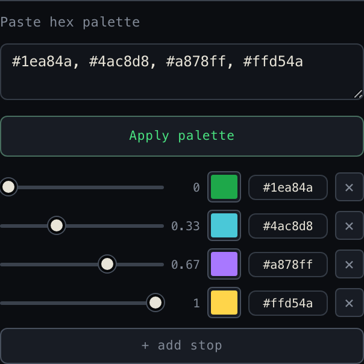

# User guide

Detailed explanation of every UI element and parameter, with worked
examples. For the quick start see [README](../README.md); for the tech
behind the curtain see [ARCHITECTURE](ARCHITECTURE.md).

<p align="center">
  
</p>

## Contents

1. [UI overview](#ui-overview)
2. [01 · Presets](#01--presets)
3. [02 · Resolution & tile](#02--resolution--tile)
4. [03 · Noise](#03--noise)
5. [04 · Color mode](#04--color-mode)
   - [RGB · per channel](#rgb--per-channel)
   - [Gradient · preset (and custom hex palettes)](#gradient--preset)
   - [HSV · hue from noise](#hsv--hue-from-noise)
   - [Posterize · steps + gradient](#posterize--steps--gradient)
   - [Cosine · a + b·cos(2π(c·t+d))](#cosine--a--bcos2πct--d)
   - [Flow · gradient direction](#flow--gradient-direction)
   - [Relief lighting](#relief-lighting)
6. [05 · Loop](#05--loop)
7. [06 · Layer 2](#06--layer-2)
8. [07 · Warp](#07--warp)
9. [08 · Mask](#08--mask)
10. [09 · Export](#09--export)
11. [Transport bar](#transport-bar)
12. [Theme toggle](#theme-toggle)
13. [Embedding (`<perlin-noise>`)](#embedding-perlin-noise)
14. [Tips and workflows](#tips-and-workflows)
15. [Keyboard shortcuts](#keyboard-shortcuts)

---

## UI overview

```
┌────────────────────────────────┬─────────────────────────────────────┐
│ SIDEBAR                        │ MAIN OUTPUT                         │
│                                │                                     │
│  01 · Presets                  │  ┌──────────────────────────────┐   │
│   [default] [lava] [aurora] …  │  │ FRAME                 • LIVE │   │
│   Save JSON | Load JSON        │  │                              │   │
│                                │  │       Live preview canvas    │   │
│  02 · Resolution & tile        │  │                              │   │
│  03 · Noise                    │  └──────────────────────────────┘   │
│  04 · Color mode               │                                     │
│  05 · Loop                     │  ▶  ⏮   ━━●━━━━ Loop progress = 0.0  │
│  06 · Layer 2  (collapsible)   │  > Ready.                  30.0 fps │
│  07 · Warp     (collapsible)   │                                     │
│  08 · Mask                     │                                     │
│  09 · Export                   │                                     │
│   fps | frames                 │                                     │
│   PNG | Record | Download      │                                     │
└────────────────────────────────┴─────────────────────────────────────┘
                                                  Topbar: brand · ☀/🌙
```

The sidebar holds all parameters, numbered top-to-bottom in the order
you usually work: **pick a Preset first**, then tune resolution, noise,
and colour, and finally export. Every input updates the preview live
(with a small debounce).

The main panel shows the canvas inside a framed area. A corner tag in
the top-right reflects the real transport state — **LIVE** (green,
pulsing) while playing, **PAUSED** (dim) when stopped, **REC** (red)
while recording. Below the canvas sits the transport bar
(Play/Pause, Reset, the time slider), a status line, and an FPS pill.

The two *advanced* sections — **Layer 2** and **Warp** — keep their
controls hidden until you turn them on (Layer 2 via its checkbox, Warp
once *strength* > 0), so the panel stays uncluttered until a feature is
in use.

---

## 01 · Presets

Presets are the fastest way to see what the tool can do — click a chip
and the whole parameter set loads and renders immediately.

### Built-in presets (chips)

| Preset | Look | Showcases |
|--------|------|-----------|
| `default` | high-contrast viridis clouds | Gradient mode |
| `lava` | deep red-orange glowing lava | `fire` gradient |
| `aurora` | cyan → green → blue polar light | HSV mode, anisotropic scale |
| `clouds` | dramatic storm-grey clouds | grayscale gradient, octaves 7 |
| `terrain` | banded contour-map landscape | Posterize, forest gradient |
| `circuit` | bright cyan/teal board pattern | Posterize, high lacunarity |
| `marble` | warm stone-vein swirls | **domain warp** |
| `nebula` | vivid magenta/purple field | **per-channel RGB noise** + warp |
| `flow` | saturated vector-field storm | **flow** colour mode |
| `composite` | layered purple/magenta on magma | **Layer 2** blend |

### Save JSON

Downloads the current parameter state as JSON
(`perlin-preset-<timestamp>.json`). Custom gradient stops travel with it.

### Load JSON

Loads a previously saved JSON file (or one you wrote yourself). Invalid
JSON produces an error in the status bar. Fields not present in the file
keep their current UI value. The same format is what the embeddable
element's `src` attribute loads.

The shape, showing a custom-gradient preset:

```json
{
  "width": 384, "height": 256, "tileX": 0, "tileY": 0,
  "scaleX": 0.015, "scaleY": 0.015, "scaleT": 0.12, "base": 7,
  "octaves": 5, "persistence": 0.65, "lacunarity": 2.2,
  "warpStrength": 1.6, "warpScale": 0.6,
  "colorMode": "gradient",
  "gradientName": "custom",
  "gradient": [
    {"pos": 0.0, "color": [12, 12, 60]},
    {"pos": 0.6, "color": [240, 110, 80]},
    {"pos": 1.0, "color": [255, 245, 200]}
  ],
  "loop": true, "loopDuration": 6, "loopRadius": 1.0
}
```

For a **named** palette, `gradientName` is the palette name (e.g.
`"fire"`) and the `gradient` array is omitted. For a **custom** palette,
`gradientName` is `"custom"` *and* the `gradient` array carries the stops.

---

## 02 · Resolution & tile

| Parameter | Range | Default | Effect |
|-----------|-------|---------|--------|
| **Width**  | 4–1024 | 256 | Render pixel width |
| **Height** | 4–1024 | 256 | Render pixel height |
| **Tile X** | 0–64 cells | 0 | When > 0, the noise X axis wraps every N cells — output tiles seamlessly horizontally |
| **Tile Y** | 0–64 cells | 0 | When > 0, the noise Y axis wraps every N cells — output tiles seamlessly vertically |

### Low-resolution "pixel" look

The canvas **fills its frame** and upscales with nearest-neighbour, so a
small Width/Height renders as crisp pixel blocks — a deliberate retro /
"Minecraft" look. The render is exactly `Width × Height` pixels; the
display just scales those up. Export (PNG/video) always uses the native
`Width × Height`, so the file stays as small/large as you set.

<table>
  <tr>
    <td width="50%"></td>
    <td width="50%"></td>
  </tr>
  <tr>
    <td align="center"><sub><b>40×27</b> → crisp pixel blocks</sub></td>
    <td align="center"><sub>The same field at full resolution</sub></td>
  </tr>
</table>

**Resolution practical advice**

- 128–256 for live parameter tweaking
- 384–512 for higher-quality export
- 8–64 for the deliberate pixel-block look
- 768+ takes noticeably longer per frame — fine for previewing, but
  animation can drop below 30 fps

### Tile X / Tile Y

The tile is measured in *noise cells*, not pixels. The physical period in
pixels is `Tile / scaleX` (or `/ scaleY`). With default `scaleX = 0.02`
and `Tile X = 8`, the horizontal tile = 400 pixels.

Tiling is independent of the seamless time loop — both can be on at once
(the noise loops in time *and* wraps in space).

**Constraints to know**

- `Tile X / Y` only affects the X and Y axes. Z (3D linear time) and W
  (4D loop time) stay infinite so the loop closure isn't disturbed.
- When **Warp** is also active, `Warp scale` is internally rounded to the
  nearest non-zero integer so the warp's wrap period lands on an integer
  cell (otherwise the seam slips by a fraction). The Warp section says so.
- High `octaves` + a small `Tile` over-constrains the noise — detail
  wraps fast and looks repetitive. Grow the tile or drop the octaves.

---

## 03 · Noise

These are the core **fractal-Brownian-motion (fBm)** controls. fBm builds
the image by stacking several layers ("octaves") of the same Perlin noise:
each octave is finer (higher frequency) and quieter (lower amplitude) than
the one before, and they're summed. So **octaves** = *how many* layers
stack (more → finer detail); **persistence** = *how loud* the finer layers
are (high → the fine layers dominate, rough; low → faint, smooth);
**lacunarity** = how much finer each layer is than the last. The pairs
below isolate one variable at a time.

### `scale x`, `scale y`

Pixel-to-noise scaling on the spatial axes — effectively the *zoom*.

<table>
  <tr>
    <td width="50%"></td>
    <td width="50%"></td>
  </tr>
  <tr>
    <td align="center"><sub><b>scale 0.008</b> · coarse, few large features</sub></td>
    <td align="center"><sub><b>scale 0.045</b> · fine, dense detail</sub></td>
  </tr>
</table>

| Value | Effect |
|-------|--------|
| 0.005 | very coarse, low detail |
| 0.02 | medium clouds (default) |
| 0.05 | fine, denser structures |
| 0.1+ | quasi-noisy pattern |

Different X/Y values give stretched structures (great for aurora bands or
horizontal waves). With **Tile X / Y** active these scales also determine
the physical tile size in pixels.

### `Time scale` (internal: `scaleT`)

Scales the time axis of the noise.

| Value | Effect |
|-------|--------|
| 0.05 | extremely slow, almost static ripple |
| 0.15 | gentle ripple (default) |
| 0.3 | visible motion |
| 0.5+ | hectic flicker (likely too fast to feel "natural") |

**Rule of thumb:** keep it similar in size to `scale x` / `scale y`. The
0.15 default is a good start for 30-fps animations.

### `base` (seed)

An integer (can be negative). Shifts the permutation table
deterministically — different seeds give completely different patterns
under otherwise identical parameters. Use the spinner arrows to "roll the
dice" until you like the composition.

### `octaves`

Number of fBm frequency levels (1–10). More octaves = more fine detail.

<table>
  <tr>
    <td width="50%"></td>
    <td width="50%"></td>
  </tr>
  <tr>
    <td align="center"><sub><b>2 octaves</b> · smooth</sub></td>
    <td align="center"><sub><b>8 octaves</b> · fine detail</sub></td>
  </tr>
</table>

| Value | Effect |
|-------|--------|
| 1 | pure smooth clouds, no detail |
| 3 | soft structures with some variation |
| 6 | classic fBm look (default) |
| 8+ | very fine detail, possibly noisy |

**Performance:** each extra octave is another noise evaluation per pixel
— roughly linear in compute time.

### `persistence`

Amplitude factor between octaves (0–2, default 0.5) — controls roughness.

<table>
  <tr>
    <td width="50%"></td>
    <td width="50%"></td>
  </tr>
  <tr>
    <td align="center"><sub><b>0.32</b> · smooth, cloud-like</sub></td>
    <td align="center"><sub><b>0.75</b> · rough, terrain-like</sub></td>
  </tr>
</table>

| Value | Effect |
|-------|--------|
| 0.3 | upper octaves very weak → smooth clouds |
| 0.5 | classic (default) |
| 0.7 | upper octaves prominent → rough terrain |
| 1.0 | all octaves equally strong → very noisy |

### `lacunarity`

Frequency factor between octaves (1–8, default 2.0).

| Value | Effect |
|-------|--------|
| 1.5 | self-similar, "organic" structures |
| 2.0 | classic (default) |
| 3.0+ | strongly differing detail levels, almost "electric" |

The `circuit` preset uses a high lacunarity for its board-like look.

**Tile note:** for clean tiling, `lacunarity` should be an integer (2 is
the default and ideal). Non-integer values scale the per-octave wrap
period and the smoke test catches the slip.

---

## 04 · Color mode

Five modes, picked from the dropdown. Each reveals its own parameter
block beneath the selector. Here is the **same noise field** under all
five:

<table>
  <tr>
    <td width="20%"></td>
    <td width="20%"></td>
    <td width="20%"></td>
    <td width="20%"></td>
    <td width="20%"></td>
  </tr>
  <tr>
    <td align="center"><sub><b>RGB</b></sub></td>
    <td align="center"><sub><b>Gradient</b></sub></td>
    <td align="center"><sub><b>HSV</b></sub></td>
    <td align="center"><sub><b>Posterize</b></sub></td>
    <td align="center"><sub><b>Flow</b></sub></td>
  </tr>
</table>

> **Shortcut:** a **`Custom hex palette →`** button sits right under the
> dropdown. Click it from any mode to jump straight to the custom-gradient
> editor (it switches to Gradient + Custom and opens the editor).

### RGB · per channel

```
r scale | g scale | b scale     (each a 0–2 slider)
r invert | g invert | b invert  (each a checkbox)
☐ Per-channel noise — each channel its own sample
```

Three independent channels. Each channel's **scale** multiplies the noise
value (0 = channel off, 1 = full, 2 = overexposed); **invert** flips it
(`1 − n`).

**Per-channel noise** (the bottom toggle): when on, the renderer samples
*three independent noise fields* per pixel and feeds one to each of
R / G / B. Channels drift apart — film-grain, nebula and stellar-cloud
looks become reachable that single-sample RGB can't do (this is what the
`nebula` preset uses). Cost: 3× the fbm work in RGB mode.

**Examples**
- pure green: `r=0, g=1, b=0`, invert g
- magenta: `r=1, g=0, b=1`, no inverts
- nebula vibes: `r=1.4, g=0.55, b=1.5`, invert g, *per-channel on*

### Gradient · preset

Pick one of eight palettes (or **Custom …**):

| Name | Character |
|------|-----------|
| Viridis | scientific, purple → teal → yellow |
| Magma | black → magenta → yellow |
| Fire | black → red → orange → white |
| Ocean | deep blue → cyan → white |
| Forest | dark green → light green → beige |
| Grayscale | black → white |
| Sunset | dark purple → orange → cream |
| Ice | deep blue → ice blue → white |
| **Custom …** | *user-defined stops — see below* |

The bar under the dropdown previews the gradient with tick labels.

#### Custom gradient & hex palettes

Pick **Custom …** (or click the `Custom hex palette →` button) and an
inline editor appears. It is built for matching an exact design / brand
palette:

<p align="center">
  
</p>

- **Paste palette** — drop a list of hex codes into the box (any
  separator — comma, space, newline; with or without `#`; 3- or 6-digit),
  e.g. `#1ea84a, #4ac8d8, #a878ff`, and hit **Apply palette**. The colours
  become stops spread evenly across the bar (3 colours → 0, 0.5, 1; 4 →
  0, 0.33, 0.67, 1; capped at 16).
- **Per-stop hex field** — type or paste an exact `#rrggbb` next to each
  swatch; it stays in sync with the colour picker both ways. Invalid text
  reverts on blur, so it can't corrupt the gradient.
- **Position slider** (0–1) with a live value readout — where the stop
  sits. Stops re-sort on release, so you can drag one past its neighbours.
- **Colour swatch** — the native colour picker, if you'd rather pick
  visually.
- **× remove** — delete the stop (disabled at the two-stop minimum).
- **+ add stop** — appends a stop in the largest gap, colour interpolated
  between its neighbours.

The custom gradient is in-memory state: it survives switching between
named presets and back, and is saved/loaded **automatically** with a JSON
preset (no hand-editing) via the `gradient` field — see
[Load JSON](#01--presets). Custom palettes are a **Gradient** and
**Posterize** feature (HSV and Flow don't use a palette).

### HSV · hue from noise

```
hue shift   (0–1)  — hue offset
hue range   (0–1)  — hue bandwidth across the image
saturation  (0–1)  — saturation (constant)
value       (0–1)  — value/brightness (constant)
```

The noise value drives the **hue** only; saturation and value are
constant → evenly-saturated, "neon" looks.

**Examples**
- Aurora: `shift=0.30, range=0.48, sat=0.88, val=1.0`
- Plasma: `shift=0, range=1, sat=1, val=1` (full rainbow)
- Sepia: `shift=0.08, range=0.1, sat=0.6, val=0.9`

### Posterize · steps + gradient

```
Steps            (2–16) — number of discrete colour levels
Gradient preset  — any palette (Custom … included)
```

The noise is quantised to N equal steps, then mapped onto the gradient —
cartoon-like banding, great for terrain height-maps and stylised effects.

### Cosine · a + b·cos(2π(c·t+d))

```
Palette  — seven ready-made ramps (Rainbow, Dusk, Rose, Citrus, Peach, Neon, Coral) or Custom …
a, b, c, d — three numbers each (R, G, B)
```

A colour ramp from a formula instead of a list of stops: each channel is `a + b·cos(2π(c·t + d))`, with `t` the noise value. `a` is the base brightness, `b` the swing, `c` how often the channel cycles over the ramp and `d` where it starts. Whole numbers for `c` make the ramp close its cycle (the lowest and highest noise values get the same colour). Editing any number switches the palette to Custom; the strip above the numbers previews the ramp. The idea and the seven starting sets are from Inigo Quilez' article *Simple color palettes*.

### Flow · gradient direction

A vector-field visualisation. Instead of mapping the noise *value* to
colour, the renderer takes a 3-point stencil per pixel and computes the
local *gradient direction*:

```
n0 = noise(x,     y)
n1 = noise(x + ε, y)
n2 = noise(x,     y + ε)
hue        = atan2(n2 − n0, n1 − n0) / 2π + 0.5 + hueShift
brightness = clamp01(floor + magnitude · gain · (1 − floor))
```

It reads like a wind map or storm front — flat areas read dark, edges and
ridges read bright with hues that rotate with the flow direction.

```
hue shift   (0–1)         — rotate the colour wheel
saturation  (0–1)         — constant saturation
gain        (0.1–20)      — magnitude → brightness multiplier
floor       (0–0.6)       — baseline brightness so flat regions aren't black
stencil ε   (0.1–3)       — pixel offset for the gradient stencil
```

Cost: 3× the fbm work (three samples per pixel). Compatible with **Warp**
and **Loop**. If the field reads too dark, raise `gain` and `floor` (the
`flow` preset uses `gain 14`, `floor 0.24`).

### Relief lighting

A switch below the colour controls that works with **every colour mode except Flow and RGB · per-channel**. It reads the noise as a height field and lights it, so a flat colour field turns into silk, stone or lava.

```
relief          (0–20)    — how steep the surface is
light direction (0–360°)  — where the light comes from, clockwise from the top (315 = top-left)
light height    (1–90°)   — angle above the surface; low = long shadows
ambient         (0–1)     — light that reaches every slope
highlight       (0–1)     — strength of the shiny spot
shininess       (2–128)   — how tight the shiny spot is
stencil ε       (0.1–4)   — pixel offset used to measure the slope
```

Flat areas keep their colour; slopes facing the light get brighter and slopes facing away darker. Cost: three noise samples per pixel (six with Layer 2), so it is a good reason to switch the **Renderer** to GPU. It works with Warp, Tile, Layer 2 and Loop. Start with `relief 3–6`; a low `light height` with `ambient 0` gives dramatic shadows.

---

## 05 · Loop

### `Seamless loop` (checkbox, default on)

- **On (loop mode):** 4D Perlin on a circular orbit. After `Loop
  duration` seconds the animation closes seamlessly back to the start.
- **Off (linear mode):** 3D Perlin with linear time — ripples gently but
  is not loopable (the video jumps at the end).

The t-slider's range/labels switch with the checkbox:
- Loop on: `[0, 1]` step 0.001, labelled *Loop progress*
- Loop off: `[-200, 2000]` step 0.01, labelled *t*

### `Loop duration (sec)`

How long a loop lasts (0.5–60 s, default 4). 2–4 s for "breathing"
loops; 6–10 s for relaxed backgrounds; 15+ s when the loop should barely
register as one.

### `Loop radius`

How far the image travels in noise space over one revolution (0–4,
default 1.0). The orbit radius is internally `loopRadius × Time scale`, so
raising **Time scale** also widens the travel.

| Value | Effect |
|-------|--------|
| 0.2 | very subtle, near-static |
| 0.5 | light ripple |
| 1.0 | visible animation (default) |
| 2.0+ | strong change; may look restless at high octaves |

`loopRadius` is multiplied by each octave's frequency, so large values +
high octaves make the highest octave race around many cells — still
seamless, but busy.

---

## 06 · Layer 2

A second noise field composited on top of the main one with a chosen
blend mode. **Tick "Enable Layer 2" to reveal its controls.** The second
field shares loop / warp / tile with Layer 1 but has its own spatial
scale, octave count, and seed.

```
n_main    = fbm₁(x · scaleX,  y · scaleY,  …)
n_layer2  = fbm₂(x · l2scaleX, y · l2scaleY, …, l2octaves, base: l2base)
composite = blend(n_main, n_layer2, blendMode)
output    = (1 − mix) · n_main + mix · composite
```

| Parameter | Range | Default | Effect |
|-----------|-------|---------|--------|
| **Enable Layer 2** | checkbox | off | Compositing is fully bypassed when off. |
| **scale x / scale y** | step 0.005 | 0.06 | Spatial scale of the second field — use a *different* value from Layer 1 for a different size of structure. |
| **octaves** | 1–10 | 4 | Octave count for the second field. |
| **base (seed)** | int | 101 | Permutation seed (kept different from Layer 1 so the fields are independent). |
| **blend mode** | dropdown | multiply | How the two fields combine — see below. |
| **mix** | 0–1 | 0.5 | Eases the blend in (0 = Layer 1 alone, 1 = full blend). |

### Blend modes

All operate on values in `[0, 1]` and return `[0, 1]`.

| Mode | Formula | Character |
|------|---------|-----------|
| **multiply** | `n₁ · n₂` | Darkens where either layer is dim. Classic emboss. |
| **add** | `min(n₁ + n₂, 1)` | Lightens; union of bright regions. Pair with low `mix`. |
| **screen** | `1 − (1 − n₁)(1 − n₂)` | Inverse of multiply; softer than add. |
| **darken** | `min(n₁, n₂)` | Keeps the darker layer; reveals contour lines. |
| **lighten** | `max(n₁, n₂)` | Keeps the brighter layer. |
| **difference** | `\|n₁ − n₂\|` | Distance between layers; sharp crossing boundaries. |

A separate seed matters: the same `base` would just add a scaled copy of
Layer 1. A distinct seed makes the fields statistically independent —
that's what makes a composite look like *two materials*.

### Mode restrictions

Layer 2 is **ignored** when `colorMode` is `flow`, or `rgb` with
Per-channel noise on — both already take three samples per pixel.
Switching to a layer-aware mode re-activates it automatically.

**Performance:** active Layer 2 ≈ 2× the per-frame cost.

---

## 07 · Warp

Domain warping — pre-displaces the noise sample point by a second,
smoother field before the main fbm runs. **The *scale* control appears
once *strength* > 0.** Output stops looking like raw Perlin: marble
veins, ink in water, alien terrain.

<table>
  <tr>
    <td width="50%"></td>
    <td width="50%"></td>
  </tr>
  <tr>
    <td align="center"><sub><b>strength 0</b> · raw noise</sub></td>
    <td align="center"><sub><b>strength 1.8</b> · marble swirls</sub></td>
  </tr>
</table>

| Parameter | Range | Default | Effect |
|-----------|-------|---------|--------|
| **strength** | 0–3 | 0 (off) | How far each sample is pushed. 0.5 = subtle veins, 1–2 = pronounced marble, 3 = chaotic. |
| **scale** | 0.1–4 | 1 | Frequency of the displacement field. < 1 = slow sweeping warp, > 1 = finer ripples. |

When **strength = 0** the warp is bypassed entirely (fast path). When
**Tile X / Y** is active, `Warp scale` is rounded internally to the
nearest non-zero integer so the displacement also closes at the seam.

**Practical tips** (these use a fractional `scale`, so keep **Tile X / Y**
at 0 — with tiling on, `scale` is rounded to an integer):
- Marble: `strength ≈ 1.5`, `scale ≈ 0.5`, octaves 3–4, `sunset` gradient
  (the `marble` preset).
- Dense swirls: crank `scale` to 2–3, lower `octaves` to 2–3.
- Ink in water: `strength ≈ 2`, `scale ≈ 0.3`, `persistence ≈ 0.4`, HSV
  with a narrow hue range.

---

## 08 · Mask

Load a PNG / JPG / WebP and use its alpha (or luminance) as a per-pixel
multiplier on the canvas alpha. Where the mask is transparent (or dark,
for opaque sources) the noise is hidden; where it's opaque (or bright) it
shows through.

| Control | Effect |
|---------|--------|
| **Load image** | File picker. A PNG with alpha is cleanest — the alpha *is* the mask. A JPG / fully-opaque PNG falls back to luminance (Rec. 709), so a black-on-white silhouette also works. |
| **Clear** | Drops the mask from memory. |
| **Apply mask** | Toggle (on after loading). Off keeps the mask in memory but unapplied — handy for A/B. |
| **Invert** | Flips the alpha — for silhouettes where you want to mask *around* the shape. |

The image is **stretched** to the current canvas resolution and cached as
alpha bytes; changing Width/Height rebuilds the cache. Match the mask's
aspect to the canvas to avoid stretching.

**Export behaviour:** PNG keeps the alpha (masked regions are
transparent). **Recording is RGB-only** — masked regions render onto whatever
is behind the canvas; the studio shows a hint at the Export button when a
mask is active.

**Uses:** branded textures inside a logo silhouette; feathered vignettes
(a radial-gradient PNG); composite passes (same noise, two masks).

---

## 09 · Export

The recording length and rate live here, next to the Record button (they
don't affect live playback, which renders at display rate):

| Control | Range | Effect |
|---------|-------|--------|
| **fps** | 1–60 | Recording framerate |
| **frames** | 1–600 | Number of frames to record |

### PNG · current frame

Saves the visible frame as PNG (`perlin-<timestamp>.png`) at the native
`Width × Height`. A masked render keeps its transparency.

### Record animation

Records `frames` frames at `fps` fps to **MP4 (H.264)** where the browser
supports it (Safari, iOS, Chrome ≥ 126) and **WebM (VP9/VP8)** otherwise
(Firefox). While recording the button becomes **Stop recording** (cancel
any time and keep the partial clip), a progress bar fills, and the corner
tag reads **REC**. When done, the canvas is replaced by a `<video>`
preview and a **Download** button (labelled with the format) appears.

**For a seamless looping video:**

1. Turn **Seamless loop** *on* (section 05) — with it off, the video
   visibly jumps where it repeats.
2. Pick a **Loop duration** (section 05); that's the video's length.
3. Set **frames = Loop duration × fps** (e.g. 6 s × 30 fps = 180 frames)
   so exactly one loop is captured.
4. Export, then play it with `<video autoplay muted loop playsinline>` —
   the video doesn't loop by itself; the `loop` attribute makes it repeat.

(With **Seamless loop** *off* the export is linear — it ripples but snaps
back where it repeats.)

### Recommended export settings

| Use case | frames | fps | Duration | Loop |
|----------|--------|-----|----------|------|
| Social snippet | 90 | 30 | 3 s | on |
| Website header loop | 180 | 30 | 6 s | on |
| Long background video | 600 | 24 | 25 s | off |
| Test / preview | 30 | 15 | 2 s | either |

The exported files are roughly 50–500 KB for short loops at moderate resolution.

---

## Transport bar

| Control | Function |
|---------|----------|
| **▶** / **⏸** | Play/pause the live animation (fills with accent while running). Also: **Space** |
| **⏮** | Slider back to 0 |
| **t slider** | Scrubbing; range/label depend on loop mode |

The slider label flips between *Loop progress* and *t* with the
**Seamless loop** checkbox. Below the bar: a `>`-prefixed status line (the
glyph flips to `!` on error) and a circuit-cyan FPS pill that appears once
playing.

The canvas corner tag shows the real state — **LIVE** / **PAUSED** /
**REC**. A brief **`rendering…`** overlay shows before the very first
frame. If the compute worker can't start, a persistent **`main thread`**
badge appears next to the status (rendering falls back to the main thread,
which is slower — see ["My browser is slow"](#my-browser-is-slow)).

---

## Theme toggle

A sun/moon icon sits at the right of the topbar. By default the page
follows `prefers-color-scheme` (your OS decides). Click once to pin Dark
or Light; the icon shows the *next* state you'd get.

- First load: follow OS theme.
- Click → explicit override, saved to `localStorage`; the PWA /
  address-bar `theme-color` updates too.
- Reload: the override is restored before the stylesheet paints (inline
  `<head>` script — no flash of the wrong theme).
- Clear it: `localStorage.removeItem("perlin-studio:theme")`, then reload.

Both themes use the same hue palette with contrast-corrected variants for
light mode. The renders, presets, and exports look identical in both —
only the chrome differs.

---

## Embedding (`<perlin-noise>`)

Besides exporting a video, you can embed the *live* animation with the
`<perlin-noise>` custom element — a renderer with no controls.

The scripts live at the **repo root** (`perlin.js`, `perlin-presets.js`,
`perlin-engine.js`, `perlin-element.js`); there's also a pre-built
**single-file bundle** at `dist/perlin-noise.js` (all four concatenated —
no build step). Copy the four files *or* the one bundle next to your page,
then drop the tag. It runs straight from `file://`; only the `src`
attribute (below, for loading a saved JSON look) needs an HTTP server.

```html
<!-- option A: the four source files, in this order -->
<script src="perlin.js"></script>
<script src="perlin-presets.js"></script>
<script src="perlin-engine.js"></script>
<script src="perlin-element.js"></script>

<!-- option B: the single bundle instead of the four above -->
<script src="perlin-noise.js"></script>

<perlin-noise preset="aurora" autoplay></perlin-noise>
```

**Configuration** (precedence high → low):

| How | Example | Notes |
|-----|---------|-------|
| `params` property | `el.params = {...}` | A full params object; wins over attributes. |
| `src` attribute | `src="loop.json"` | A preset exported via **Save JSON**. Needs HTTP — `fetch` is blocked under `file://`. |
| `preset` attribute | `preset="lava"` | A built-in name. Works under `file://`. |
| (none) | | Falls back to the `default` preset. |

**Other attributes:** `autoplay`, `static` (force a single still frame),
`max-resolution` (render cap on the longest edge, default 1280).

**Behaviour:** the element fills its container and renders at the displayed
size × devicePixelRatio, capped at `max-resolution`, so a full-bleed hero
stays cheap. The preset's width/height act as a reference so the look is
the same at any size. It renders one still frame under **Reduce motion**
and pauses while scrolled off-screen.

### Recipe: full-bleed hero background

```html
<section class="hero">
  <perlin-noise preset="aurora" autoplay max-resolution="1280"></perlin-noise>
  <h1>Your headline</h1>
</section>
```
```css
.hero { position: relative; min-height: 70vh; display: grid; place-items: center; overflow: hidden; }
.hero perlin-noise { position: absolute; inset: 0; z-index: 0; }
.hero h1 { position: relative; z-index: 1; text-shadow: 0 2px 16px rgba(0,0,0,.6); }
```

### Recipe: your own look, designed in the studio

Dial in a look, click **Save JSON**, drop the file next to your page and
point `src` at it (needs an HTTP server):

```html
<perlin-noise src="my-look.json" autoplay></perlin-noise>
```

The JSON round-trips exactly — including a custom gradient.

### Recipe: drive it from JavaScript

```js
const el = document.querySelector("perlin-noise");
el.params = { colorMode: "gradient", gradientName: "fire",
              scaleX: 0.02, scaleY: 0.02, octaves: 5,
              loop: true, loopDuration: 6, loopRadius: 1 };
el.play();   // or el.pause(); el.playing → boolean
```

`gradientName` is expanded to concrete stops for you.

### Recipe: tuning cost

- **`max-resolution`** is the main dial — halving it quarters the work.
- **Octaves** in the preset is the other big lever.
- **Many instances:** each element spawns its own worker. One hero is
  ideal; for a grid of many, prefer one larger element or exported video
  thumbnails.

A runnable demo lives in **[examples/embed.html](../examples/embed.html)**
([live](https://pages.jkaindl.de/perlin-studio/examples/embed.html)).

---

## Tips and workflows

### "I want a background loop for my homepage"

- **Live element:** embed `<perlin-noise preset="aurora" autoplay>` — it
  loops forever, scales to the container, respects reduced motion.
- **Exported video:** load `clouds` or `aurora`, set `Loop duration`
  6–10 s, size to your layout, export a clip (fps 24, frames 144 = 6 s),
  then `<video autoplay muted loop playsinline>`.

### "I want a seamlessly tileable texture"

1. Pick `clouds` or `terrain`, turn the loop **off**.
2. Set `Tile X` / `Tile Y` to a small integer (4–8).
3. Resolution to target size; the tile is `Tile / scaleX` pixels wide.
4. With **Warp**, integer `Warp scale` is enforced automatically.
5. Export PNG.

### "I want a low-res pixel-art texture"

1. Set Width/Height small (e.g. 32–64) — the canvas shows crisp blocks.
2. Pick a punchy gradient or Posterize for chunky colour bands.
3. Export PNG (it saves at the native small resolution).

### "I want a generative texture for a game"

1. `terrain` or `circuit`, loop off, resolution 512–1024.
2. (Optional) set `Tile X / Y` to repeat. Export PNG.

### "I'm testing different seeds"

Click the `base` spinner arrows — the preview updates immediately. Save a
JSON preset when you like one.

### "I want a flow-field look"

1. `flow` preset. 2. `gain` controls brightness of high-magnitude regions.
3. `hue shift` rotates the wheel to a brand colour. 4. `stencil ε` sets
the ridge sharpness.

### "I want a marble-like material"

1. `marble` preset. 2. `Warp scale` 0.4–0.6 for sweeping veins. 3.
`octaves` 3–4 keeps it painterly. 4. `sunset`/`fire` for warm, `ice`/a
custom blue for cool.

### "I want nebula colours"

1. `nebula` preset. 2. Toggle channel inverts to flip colour
relationships. 3. Adjust `base` for a new composition.

### "I want to match an exact brand palette"

1. Click **`Custom hex palette →`** (or Colour mode → Gradient →
   `Custom …`).
2. Paste your brand's hex codes into the **Paste palette** box → Apply.
3. Fine-tune any stop's `#hex` field or position. Save as JSON to reuse.

### "I want noise inside a logo / silhouette"

1. Save the logo as a PNG (shape opaque, rest transparent).
2. Section 08 → Load image. Apply is on; try **Invert** if needed.
3. Match canvas Width/Height to the logo aspect. Export PNG (keeps
   transparency).

### "I want a composite cloud-and-grain texture"

1. `composite` preset. 2. In Layer 2, bump octaves for detail or lower
`mix` to fade it in. 3. Try `screen` (brighter) or `difference` (sharp).
4. Lock both seeds by saving JSON.

<a id="my-browser-is-slow"></a>
### "My browser is slow"

- Lower the resolution (128–192) and octaves (3–4).
- Set `Warp strength` to 0 (fast path).
- Avoid `Flow` mode for high-res previews (3× the per-pixel cost).
- If a **`main thread`** badge is showing, the heavy noise maths is running
  on the page's main thread instead of a background **Web Worker** — much
  slower, and it can make the UI stutter. This happens when a browser blocks
  workers for a page opened straight from disk (a `file://…` URL, i.e.
  double-clicking `index.html`); it's most common in Safari but any browser
  can do it. The one-time fix: serve the folder over HTTP — run
  `python3 -m http.server 8000` in the project folder once and open
  `http://localhost:8000`. (The deployed site already runs over HTTP, so
  it's never affected.)

---

## Keyboard shortcuts

| Key | Action |
|-----|--------|
| **Space** | Play / pause (ignored while an input is focused) |
| **↑ / ↓** | Step the focused number input by its `step` |
| **Tab / Shift+Tab** | Cycle through controls |

There are intentionally few shortcuts — the controls are mouse- and
trackpad-first. Space-to-play is the one that materially speeds up
iteration.
