# How the parameters shape the image

The control reference lists every range; this page is about what the controls *do* to the picture and why. Each pair below changes one variable and keeps the rest.

## Fractal noise in one paragraph

These are the core **fractal-Brownian-motion (fBm)** controls. fBm builds
the image by stacking several layers ("octaves") of the same Perlin noise:
each octave is finer (higher frequency) and quieter (lower amplitude) than
the one before, and they're summed. So **octaves** = *how many* layers
stack (more → finer detail); **persistence** = *how loud* the finer layers
are (high → the fine layers dominate, rough; low → faint, smooth);
**lacunarity** = how much finer each layer is than the last. The pairs
below isolate one variable at a time.

## Pixels, not units: the low-resolution look

The canvas **fills its frame** and upscales with nearest-neighbour, so a small Width/Height renders as crisp pixel blocks — a deliberate retro / "Minecraft" look. The render is exactly `Width × Height` pixels; the display just scales those up. A PNG export always has the native `Width × Height`.

<table>
  <tr>
    <td width="50%">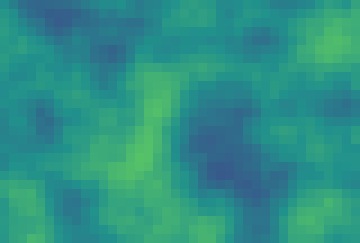</td>
    <td width="50%">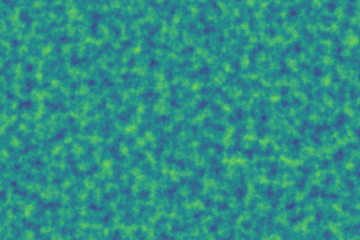</td>
  </tr>
  <tr>
    <td align="center"><b>40×27</b> → crisp pixel blocks</td>
    <td align="center">The same field at full resolution</td>
  </tr>
</table>

## Scale: the zoom

`scale x` and `scale y` convert pixels into noise space, so they are the zoom. Different values for x and y stretch the structures (aurora bands, horizontal waves). With **Tile X / Y** on, the scales also set the tile size in pixels (`Tile / scale`).

<table>
  <tr>
    <td width="50%">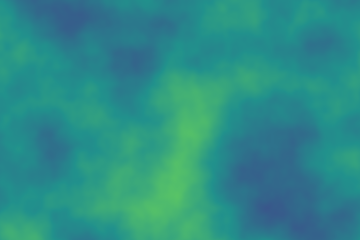</td>
    <td width="50%">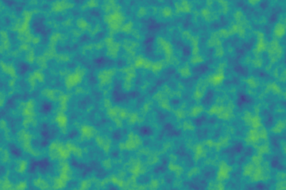</td>
  </tr>
  <tr>
    <td align="center"><b>scale 0.008</b> · coarse, few large features</td>
    <td align="center"><b>scale 0.045</b> · fine, dense detail</td>
  </tr>
</table>

## Octaves: how much fine detail

Each octave is one more evaluation of the noise per pixel, at twice the frequency and half the loudness. Cost grows roughly linearly with the count.

<table>
  <tr>
    <td width="50%">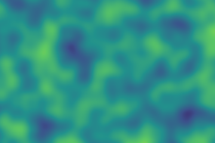</td>
    <td width="50%">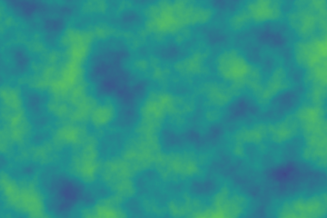</td>
  </tr>
  <tr>
    <td align="center"><b>2 octaves</b> · smooth</td>
    <td align="center"><b>8 octaves</b> · fine detail</td>
  </tr>
</table>

## Persistence: smooth or rough

Persistence is the loudness ratio between neighbouring octaves. Low values let the fine layers fade (clouds), high values keep them (terrain, grain).

<table>
  <tr>
    <td width="50%"></td>
    <td width="50%">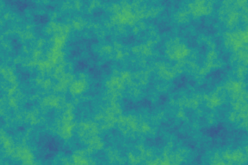</td>
  </tr>
  <tr>
    <td align="center"><b>0.32</b> · smooth, cloud-like</td>
    <td align="center"><b>0.75</b> · rough, terrain-like</td>
  </tr>
</table>

## The same noise in five colour modes

The colour mode only changes how the noise value becomes a colour; the field underneath is identical.

<table>
  <tr>
    <td width="20%">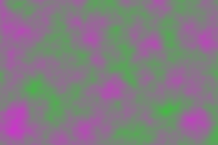</td>
    <td width="20%">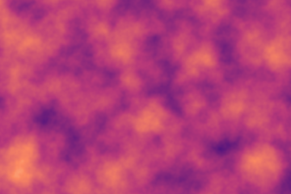</td>
    <td width="20%">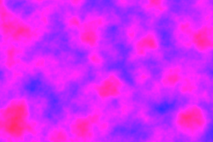</td>
    <td width="20%">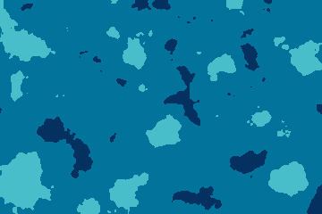</td>
    <td width="20%">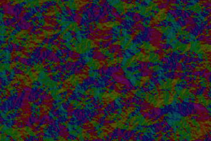</td>
  </tr>
  <tr>
    <td align="center"><b>RGB</b></td>
    <td align="center"><b>Gradient</b></td>
    <td align="center"><b>HSV</b></td>
    <td align="center"><b>Posterize</b></td>
    <td align="center"><b>Flow</b></td>
  </tr>
</table>

## Warp: from noise to marble

Domain warping pushes each sample point by a second, smoother field before the main noise is read. A small strength gives veins, a large one swirls.

<table>
  <tr>
    <td width="50%"></td>
    <td width="50%">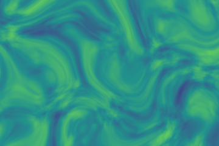</td>
  </tr>
  <tr>
    <td align="center"><b>strength 0</b> · raw noise</td>
    <td align="center"><b>strength 1.8</b> · marble swirls</td>
  </tr>
</table>

## Where to go next

- Every range and default: [Control reference](../reference/controls.md).
- How the maths is built: [Architecture](architecture.md).
- A look to start from: [Get a specific look](../how-to/get-a-specific-look.md).
