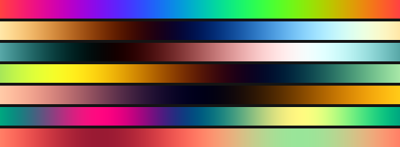
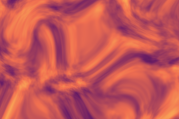
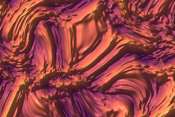

# Colour modes and relief lighting

Reference for section **04 · Color mode** of the sidebar: the six colour modes, their controls and ranges, and the relief-lighting overlay that works on top of them. For a task-shaped walk-through see [Match a brand palette](../how-to/match-a-brand-palette.md) and [Get a specific look](../how-to/get-a-specific-look.md).

## Contents

- [RGB · per channel](#rgb--per-channel)
- [Gradient · preset](#gradient--preset)
- [HSV · hue from noise](#hsv--hue-from-noise)
- [Posterize · steps + gradient](#posterize--steps--gradient)
- [Cosine · a + b·cos(2π(c·t+d))](#cosine--a--bcos2πctd)
- [Flow · gradient direction](#flow--gradient-direction)
- [Relief lighting](#relief-lighting)

> **Shortcut:** a **`Custom hex palette →`** button sits right under the dropdown. Click it from any mode to jump straight to the custom-gradient editor (it switches to Gradient + Custom and opens the editor).

### RGB · per channel

```
r scale | g scale | b scale     (each a 0–2 slider)
r invert | g invert | b invert  (each a checkbox)
☐ Per-channel noise — each channel its own sample
```

Three independent channels. Each channel's **scale** multiplies the noise
value (0 = channel off, 1 = full, 2 = overexposed); **invert** flips it
(`1 − n`).

**Per-channel noise** (the bottom toggle): when on, the renderer samples
*three independent noise fields* per pixel and feeds one to each of
R / G / B. Channels drift apart — film-grain, nebula and stellar-cloud
looks become reachable that single-sample RGB can't do (this is what the
`nebula` preset uses). Cost: 3× the fbm work in RGB mode.

**Examples**
- pure green: `r=0, g=1, b=0`, invert g
- magenta: `r=1, g=0, b=1`, no inverts
- nebula vibes: `r=1.4, g=0.55, b=1.5`, invert g, *per-channel on*

### Gradient · preset

Pick one of eight palettes (or **Custom …**):

| Name | Character |
|------|-----------|
| Viridis | scientific, purple → teal → yellow |
| Magma | black → magenta → yellow |
| Fire | black → red → orange → white |
| Ocean | deep blue → cyan → white |
| Forest | dark green → light green → beige |
| Grayscale | black → white |
| Sunset | dark purple → orange → cream |
| Ice | deep blue → ice blue → white |
| **Custom …** | *user-defined stops — see below* |

The bar under the dropdown previews the gradient with tick labels.

#### Custom gradient & hex palettes

Pick **Custom …** (or click the `Custom hex palette →` button) and an
inline editor appears. It is built for matching an exact design / brand
palette:

<p align="center">
  
</p>

- **Paste palette** — drop a list of hex codes into the box (any
  separator — comma, space, newline; with or without `#`; 3- or 6-digit),
  e.g. `#1ea84a, #4ac8d8, #a878ff`, and hit **Apply palette**. The colours
  become stops spread evenly across the bar (3 colours → 0, 0.5, 1; 4 →
  0, 0.33, 0.67, 1; capped at 16).
- **Per-stop hex field** — type or paste an exact `#rrggbb` next to each
  swatch; it stays in sync with the colour picker both ways. Invalid text
  reverts on blur, so it can't corrupt the gradient.
- **Position slider** (0–1) with a live value readout — where the stop
  sits. Stops re-sort on release, so you can drag one past its neighbours.
- **Colour swatch** — the native colour picker, if you'd rather pick
  visually.
- **× remove** — delete the stop (disabled at the two-stop minimum).
- **+ add stop** — appends a stop in the largest gap, colour interpolated
  between its neighbours.

The custom gradient is in-memory state: it survives switching between
named presets and back, and is saved/loaded **automatically** with a JSON
preset (no hand-editing) via the `gradient` field — see
[the preset format](preset-format.md). Custom palettes are a **Gradient** and
**Posterize** feature (HSV and Flow don't use a palette).

### HSV · hue from noise

```
hue shift   (0–1)  — hue offset
hue range   (0–1)  — hue bandwidth across the image
saturation  (0–1)  — saturation (constant)
value       (0–1)  — value/brightness (constant)
```

The noise value drives the **hue** only; saturation and value are
constant → evenly-saturated, "neon" looks.

**Examples**
- Aurora: `shift=0.30, range=0.48, sat=0.88, val=1.0`
- Plasma: `shift=0, range=1, sat=1, val=1` (full rainbow)
- Sepia: `shift=0.08, range=0.1, sat=0.6, val=0.9`

### Posterize · steps + gradient

```
Steps            (2–16) — number of discrete colour levels
Gradient preset  — any palette (Custom … included)
```

The noise is quantised to N equal steps, then mapped onto the gradient —
cartoon-like banding, great for terrain height-maps and stylised effects.

### Cosine · a + b·cos(2π(c·t+d))

```
Palette  — seven ready-made ramps (Rainbow, Dusk, Rose, Citrus, Peach, Neon, Coral) or Custom …
a, b, c, d — three numbers each (R, G, B)
```

A colour ramp from a formula instead of a list of stops: each channel is `a + b·cos(2π(c·t + d))`, with `t` the noise value. `a` is the base brightness, `b` the swing, `c` how often the channel cycles over the ramp and `d` where it starts. Whole numbers for `c` make the ramp close its cycle (the lowest and highest noise values get the same colour). Editing any number switches the palette to Custom; the strip above the numbers previews the ramp. The seven built-in palettes, top to bottom: rainbow, dusk, rose, citrus, peach, neon, coral.

<p align="center">
  
</p>
 The idea and the seven starting sets are from Inigo Quilez' article *Simple color palettes*.

### Flow · gradient direction

A vector-field visualisation. Instead of mapping the noise *value* to
colour, the renderer takes a 3-point stencil per pixel and computes the
local *gradient direction*:

```
n0 = noise(x,     y)
n1 = noise(x + ε, y)
n2 = noise(x,     y + ε)
hue        = atan2(n2 − n0, n1 − n0) / 2π + 0.5 + hueShift
brightness = clamp01(floor + magnitude · gain · (1 − floor))
```

It reads like a wind map or storm front — flat areas read dark, edges and
ridges read bright with hues that rotate with the flow direction.

```
hue shift   (0–1)         — rotate the colour wheel
saturation  (0–1)         — constant saturation
gain        (0.1–20)      — magnitude → brightness multiplier
floor       (0–0.6)       — baseline brightness so flat regions aren't black
stencil ε   (0.1–3)       — pixel offset for the gradient stencil
```

Cost: 3× the fbm work (three samples per pixel). Compatible with **Warp**
and **Loop**. If the field reads too dark, raise `gain` and `floor` (the
`flow` preset uses `gain 14`, `floor 0.24`).

### Relief lighting

A switch below the colour controls that works with **every colour mode except Flow and RGB · per-channel**. It reads the noise as a height field and lights it, so a flat colour field turns into silk, stone or lava.

```
relief          (0–20)    — how steep the surface is
light direction (0–360°)  — where the light comes from, clockwise from the top (315 = top-left)
light height    (1–90°)   — angle above the surface; low = long shadows
ambient         (0–1)     — light that reaches every slope
highlight       (0–1)     — strength of the shiny spot
shininess       (2–128)   — how tight the shiny spot is
stencil ε       (0.1–4)   — pixel offset used to measure the slope
```

Flat areas keep their colour; slopes facing the light get brighter and slopes facing away darker. Cost: three noise samples per pixel (six with Layer 2), so it is a good reason to switch the **Renderer** to GPU. It works with Warp, Tile, Layer 2 and Loop. Start with `relief 3–6`; a low `light height` with `ambient 0` gives dramatic shadows.

<table>
  <tr>
    <td width="50%"></td>
    <td width="50%"></td>
  </tr>
  <tr>
    <td align="center"><sub><b>off</b></sub></td>
    <td align="center"><sub><b>relief 4</b>, light from the top-left at 45°</sub></td>
  </tr>
</table>
