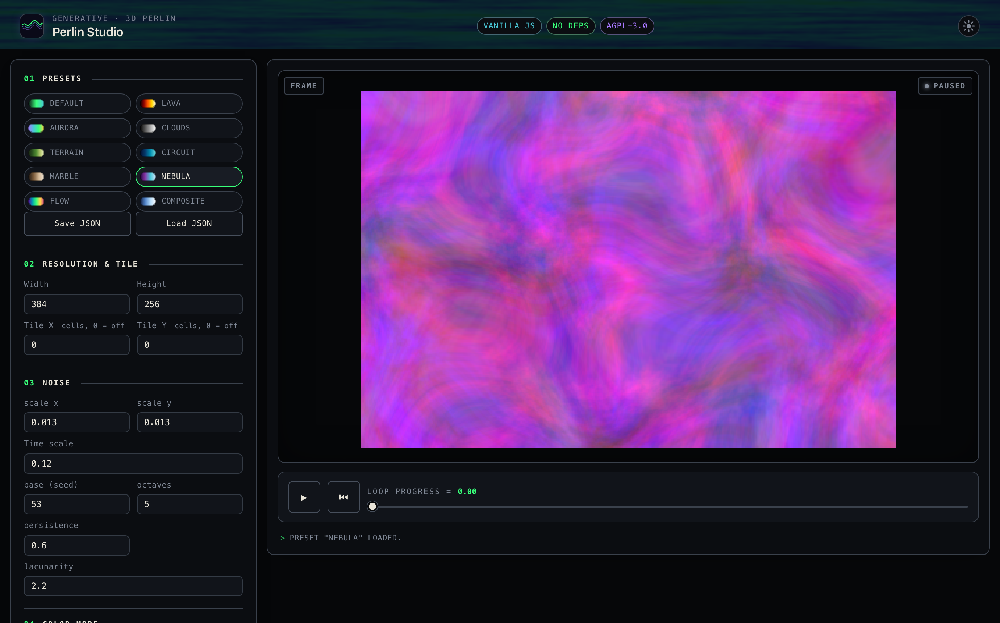

# Control reference

Every control of the Perlin Studio sidebar, its range, default and effect. This page describes; for a task see the [how-to guides](../README.md#how-to-guides), for a first walk-through the [tutorial](../tutorials/getting-started.md). Colour modes and relief lighting have their own page: [Colour modes and relief lighting](colour-modes.md). The preset file format is in [Preset format](preset-format.md).

<p align="center">
  
</p>

## Contents

1. [UI overview](#ui-overview)
2. [01 · Presets](#01--presets)
3. [02 · Resolution & tile](#02--resolution--tile)
4. [03 · Noise](#03--noise)
5. [04 · Color mode](colour-modes.md)
6. [05 · Loop](#05--loop)
7. [06 · Layer 2](#06--layer-2)
8. [07 · Warp](#07--warp)
9. [08 · Mask](#08--mask)
10. [09 · Export](#09--export)
11. [Transport bar](#transport-bar)
12. [Theme toggle](#theme-toggle)
13. [Keyboard shortcuts](#keyboard-shortcuts)

---

## UI overview

```
┌────────────────────────────────┬─────────────────────────────────────┐
│ SIDEBAR                        │ MAIN OUTPUT                         │
│                                │                                     │
│  01 · Presets                  │  ┌──────────────────────────────┐   │
│   [default] [lava] [aurora] …  │  │ FRAME                 • LIVE │   │
│   Save JSON | Load JSON        │  │                              │   │
│                                │  │       Live preview canvas    │   │
│  02 · Resolution & tile        │  │                              │   │
│  03 · Noise                    │  └──────────────────────────────┘   │
│  04 · Color mode               │                                     │
│  05 · Loop                     │  ▶  ⏮   ━━●━━━━ Loop progress = 0.0  │
│  06 · Layer 2  (collapsible)   │  > Ready.                  30.0 fps │
│  07 · Warp     (collapsible)   │                                     │
│  08 · Mask                     │                                     │
│  09 · Export                   │                                     │
│   fps | frames                 │                                     │
│   PNG | Record | Download      │                                     │
└────────────────────────────────┴─────────────────────────────────────┘
                                                  Topbar: brand · ☀/🌙
```

The sidebar holds all parameters, numbered top-to-bottom in the order
you usually work: **pick a Preset first**, then tune resolution, noise,
and colour, and finally export. Every input updates the preview live
(with a small debounce).

The main panel shows the canvas inside a framed area. A corner tag in
the top-right reflects the real transport state — **LIVE** (green,
pulsing) while playing, **PAUSED** (dim) when stopped, **REC** (red)
while recording. Below the canvas sits the transport bar
(Play/Pause, Reset, the time slider), a status line, and an FPS pill.

The two *advanced* sections — **Layer 2** and **Warp** — keep their
controls hidden until you turn them on (Layer 2 via its checkbox, Warp
once *strength* > 0), so the panel stays uncluttered until a feature is
in use.

---

## 01 · Presets

Presets are the fastest way to see what the tool can do — click a chip
and the whole parameter set loads and renders immediately.

### Built-in presets (chips)

| Preset | Look | Showcases |
|--------|------|-----------|
| `default` | high-contrast viridis clouds | Gradient mode |
| `lava` | deep red-orange glowing lava | `fire` gradient |
| `aurora` | cyan → green → blue polar light | HSV mode, anisotropic scale |
| `clouds` | dramatic storm-grey clouds | grayscale gradient, octaves 7 |
| `terrain` | banded contour-map landscape | Posterize, forest gradient |
| `circuit` | bright cyan/teal board pattern | Posterize, high lacunarity |
| `marble` | warm stone-vein swirls | **domain warp** |
| `nebula` | vivid magenta/purple field | **per-channel RGB noise** + warp |
| `flow` | saturated vector-field storm | **flow** colour mode |
| `composite` | layered purple/magenta on magma | **Layer 2** blend |

### Save JSON

Downloads the current parameter state as JSON
(`perlin-preset-<timestamp>.json`). Custom gradient stops travel with it.

### Load JSON

Loads a previously saved JSON file (or one you wrote yourself). Invalid
JSON produces an error in the status bar. Fields not present in the file
keep their current UI value. The same format is what the embeddable
element's `src` attribute loads.


The file shape and every key are in [Preset format](preset-format.md).

---

## 02 · Resolution & tile

| Parameter | Range | Default | Effect |
|-----------|-------|---------|--------|
| **Width**  | 4–1024 | 256 | Render pixel width |
| **Height** | 4–1024 | 256 | Render pixel height |
| **Tile X** | 0–64 cells | 0 | When > 0, the noise X axis wraps every N cells — output tiles seamlessly horizontally |
| **Tile Y** | 0–64 cells | 0 | When > 0, the noise Y axis wraps every N cells — output tiles seamlessly vertically |


### Renderer

A select under the tile fields: **CPU · worker** (the default) or **GPU · WebGL2**. Both draw the same image from the same parameters; the GPU is much faster at large sizes. The choice is a viewer setting remembered in the browser — it is not part of a preset and does not change an export. The GPU option is disabled when the browser has no WebGL2. Flow, RGB · per-channel and gradients with more than 16 stops are rendered on the CPU even when GPU is selected; a GPU failure switches back to the CPU for good. The fps readout adds **· GPU** while the GPU draws. See [Use the GPU renderer](../how-to/use-the-gpu-renderer.md).

### Pixel look

A small Width/Height shows as crisp pixel blocks (see [How the parameters shape the image](../explanation/how-the-parameters-shape-the-image.md#pixels-not-units-the-low-resolution-look)). Practical sizes: 128–256 for live tweaking, 384–512 for export, 8–64 for the pixel-block look; 768+ is noticeably slower per frame on the CPU.

### Tile X / Tile Y

The tile is measured in *noise cells*, not pixels. The physical period in
pixels is `Tile / scaleX` (or `/ scaleY`). With default `scaleX = 0.02`
and `Tile X = 8`, the horizontal tile = 400 pixels.

Tiling is independent of the seamless time loop — both can be on at once
(the noise loops in time *and* wraps in space).

**Constraints to know**

- `Tile X / Y` only affects the X and Y axes. Z (3D linear time) and W
  (4D loop time) stay infinite so the loop closure isn't disturbed.
- When **Warp** is also active, `Warp scale` is internally rounded to the
  nearest non-zero integer so the warp's wrap period lands on an integer
  cell (otherwise the seam slips by a fraction). The Warp section says so.
- High `octaves` + a small `Tile` over-constrains the noise — detail
  wraps fast and looks repetitive. Grow the tile or drop the octaves.

---

## 03 · Noise

These are the fractal (fBm) noise controls. How they shape the picture is shown in [How the parameters shape the image](../explanation/how-the-parameters-shape-the-image.md).

### `scale x`, `scale y`

Pixel-to-noise scaling on the spatial axes — effectively the *zoom*.


| Value | Effect |
|-------|--------|
| 0.005 | very coarse, low detail |
| 0.02 | medium clouds (default) |
| 0.05 | fine, denser structures |
| 0.1+ | quasi-noisy pattern |

Different X/Y values give stretched structures (great for aurora bands or
horizontal waves). With **Tile X / Y** active these scales also determine
the physical tile size in pixels.

### `Time scale` (internal: `scaleT`)

Scales the time axis of the noise.

| Value | Effect |
|-------|--------|
| 0.05 | extremely slow, almost static ripple |
| 0.15 | gentle ripple (default) |
| 0.3 | visible motion |
| 0.5+ | hectic flicker (likely too fast to feel "natural") |

**Rule of thumb:** keep it similar in size to `scale x` / `scale y`. The
0.15 default is a good start for 30-fps animations.

### `base` (seed)

An integer (can be negative). Shifts the permutation table
deterministically — different seeds give completely different patterns
under otherwise identical parameters. Use the spinner arrows to "roll the
dice" until you like the composition.

### `octaves`

Number of fBm frequency levels (1–10). More octaves = more fine detail.


| Value | Effect |
|-------|--------|
| 1 | pure smooth clouds, no detail |
| 3 | soft structures with some variation |
| 6 | classic fBm look (default) |
| 8+ | very fine detail, possibly noisy |

**Performance:** each extra octave is another noise evaluation per pixel
— roughly linear in compute time.

### `persistence`

Amplitude factor between octaves (0–2, default 0.5) — controls roughness.


| Value | Effect |
|-------|--------|
| 0.3 | upper octaves very weak → smooth clouds |
| 0.5 | classic (default) |
| 0.7 | upper octaves prominent → rough terrain |
| 1.0 | all octaves equally strong → very noisy |

### `lacunarity`

Frequency factor between octaves (1–8, default 2.0).

| Value | Effect |
|-------|--------|
| 1.5 | self-similar, "organic" structures |
| 2.0 | classic (default) |
| 3.0+ | strongly differing detail levels, almost "electric" |

The `circuit` preset uses a high lacunarity for its board-like look.

**Tile note:** for clean tiling, `lacunarity` should be an integer (2 is
the default and ideal). Non-integer values scale the per-octave wrap
period and the smoke test catches the slip.

### `Noise type`

```
Perlin · fBm                          — the classic smooth noise (default)
Cells · distance to the nearest point — Worley / Voronoi: dark at the points, bright between them
Borders · cell edges                  — dark lines along the borders between cells
Smooth cells · soft blobs             — a smooth minimum of the distances: metaballs
cell jitter (0–1)                     — 0 is a regular grid, 1 fully random inside each cell
```

The cellular types use the same `base` seed, `scale`, `octaves`, `persistence` and `lacunarity` as Perlin, and they work with Warp, Tile, Layer 2, Relief lighting and every colour mode. Use **1–2 octaves** for clean cells; with more, the fine layers turn them to grain. They animate by letting each point circle inside its own cell, so the **Loop** closes exactly (the loop radius has no effect on them; the **Time scale** sets the speed when Loop is off). Layer 2 uses the same noise type as the main layer. A side-by-side of the four types is in [How the parameters shape the image](../explanation/how-the-parameters-shape-the-image.md#noise-types-smooth-noise-or-cells).

---

## 05 · Loop

### `Seamless loop` (checkbox, default on)

- **On (loop mode):** 4D Perlin on a circular orbit. After `Loop
  duration` seconds the animation closes seamlessly back to the start.
- **Off (linear mode):** 3D Perlin with linear time — ripples gently but
  is not loopable (the video jumps at the end).

The t-slider's range/labels switch with the checkbox:
- Loop on: `[0, 1]` step 0.001, labelled *Loop progress*
- Loop off: `[-200, 2000]` step 0.01, labelled *t*

### `Loop duration (sec)`

How long a loop lasts (0.5–60 s, default 4). 2–4 s for "breathing"
loops; 6–10 s for relaxed backgrounds; 15+ s when the loop should barely
register as one.

### `Loop radius`

How far the image travels in noise space over one revolution (0–4,
default 1.0). The orbit radius is internally `loopRadius × Time scale`, so
raising **Time scale** also widens the travel.

| Value | Effect |
|-------|--------|
| 0.2 | very subtle, near-static |
| 0.5 | light ripple |
| 1.0 | visible animation (default) |
| 2.0+ | strong change; may look restless at high octaves |

`loopRadius` is multiplied by each octave's frequency, so large values +
high octaves make the highest octave race around many cells — still
seamless, but busy.

---

## 06 · Layer 2

A second noise field composited on top of the main one with a chosen
blend mode. **Tick "Enable Layer 2" to reveal its controls.** The second
field shares loop / warp / tile with Layer 1 but has its own spatial
scale, octave count, and seed.

```
n_main    = fbm₁(x · scaleX,  y · scaleY,  …)
n_layer2  = fbm₂(x · l2scaleX, y · l2scaleY, …, l2octaves, base: l2base)
composite = blend(n_main, n_layer2, blendMode)
output    = (1 − mix) · n_main + mix · composite
```

| Parameter | Range | Default | Effect |
|-----------|-------|---------|--------|
| **Enable Layer 2** | checkbox | off | Compositing is fully bypassed when off. |
| **scale x / scale y** | step 0.005 | 0.06 | Spatial scale of the second field — use a *different* value from Layer 1 for a different size of structure. |
| **octaves** | 1–10 | 4 | Octave count for the second field. |
| **base (seed)** | int | 101 | Permutation seed (kept different from Layer 1 so the fields are independent). |
| **blend mode** | dropdown | multiply | How the two fields combine — see below. |
| **mix** | 0–1 | 0.5 | Eases the blend in (0 = Layer 1 alone, 1 = full blend). |

### Blend modes

All operate on values in `[0, 1]` and return `[0, 1]`.

| Mode | Formula | Character |
|------|---------|-----------|
| **multiply** | `n₁ · n₂` | Darkens where either layer is dim. Classic emboss. |
| **add** | `min(n₁ + n₂, 1)` | Lightens; union of bright regions. Pair with low `mix`. |
| **screen** | `1 − (1 − n₁)(1 − n₂)` | Inverse of multiply; softer than add. |
| **darken** | `min(n₁, n₂)` | Keeps the darker layer; reveals contour lines. |
| **lighten** | `max(n₁, n₂)` | Keeps the brighter layer. |
| **difference** | `\|n₁ − n₂\|` | Distance between layers; sharp crossing boundaries. |

A separate seed matters: the same `base` would just add a scaled copy of
Layer 1. A distinct seed makes the fields statistically independent —
that's what makes a composite look like *two materials*.

### Mode restrictions

Layer 2 is **ignored** when `colorMode` is `flow`, or `rgb` with
Per-channel noise on — both already take three samples per pixel.
Switching to a layer-aware mode re-activates it automatically.

**Performance:** active Layer 2 ≈ 2× the per-frame cost.

---

## 07 · Warp

Domain warping — pre-displaces the noise sample point by a second,
smoother field before the main fbm runs. **The *scale* control appears
once *strength* > 0.** Output stops looking like raw Perlin: marble
veins, ink in water, alien terrain.


| Parameter | Range | Default | Effect |
|-----------|-------|---------|--------|
| **strength** | 0–3 | 0 (off) | How far each sample is pushed. 0.5 = subtle veins, 1–2 = pronounced marble, 3 = chaotic. |
| **scale** | 0.1–4 | 1 | Frequency of the displacement field. < 1 = slow sweeping warp, > 1 = finer ripples. |

When **strength = 0** the warp is bypassed entirely (fast path). When
**Tile X / Y** is active, `Warp scale` is rounded internally to the
nearest non-zero integer so the displacement also closes at the seam.


---

## 08 · Mask

Load a PNG / JPG / WebP and use its alpha (or luminance) as a per-pixel multiplier on the canvas alpha. Where the mask is transparent (or dark, for opaque sources) the noise is hidden; where it is opaque (or bright) it shows through.

| Control | Effect |
|---------|--------|
| **Load image** | File picker. A PNG with alpha is cleanest — the alpha *is* the mask. A JPG / fully-opaque PNG falls back to luminance (Rec. 709), so a black-on-white silhouette also works. |
| **Clear** | Drops the mask from memory. |
| **Apply mask** | Toggle (on after loading). Off keeps the mask in memory but unapplied — handy for A/B. |
| **Invert** | Flips the alpha — for silhouettes where you want to mask *around* the shape. |

The image is **stretched** to the current canvas resolution and cached as alpha bytes; changing Width/Height rebuilds the cache. Match the mask's aspect to the canvas to avoid stretching.

**Where it applies:** the live preview, the PNG export (masked regions are transparent) and the video export, which bakes the mask into the frames together with the chosen background (see 09). A task-shaped guide is [Cut noise out with a mask](../how-to/cut-noise-out-with-a-mask.md).

---

## 09 · Export

The Export section renders the animation to a video; the mask and the chosen background are baked into the frames. Length and rate live here, next to the Record button (they do not affect live playback, which renders at display rate).

| Control | Range | Effect |
|---------|-------|--------|
| **resolution** | Match canvas · 1080×1920 portrait · 1920×1080 landscape · 1080×1080 square · 1440×2560 portrait HiDPI · 2160×3840 4K portrait · Custom… | Output size of the video, independent of the on-screen canvas. Custom takes 16–4096 per side. |
| **fps** | 1–60 | Recording frame rate |
| **frames** | 1–600 | Number of frames to record |
| **background** | Solid color · Image · Transparent (best-effort) | What the noise is composited over. Colour: a colour picker (default `#0a0a18`). Image: **Load background image**, with **fit** Cover or Contain; without one it uses the mask image. Transparent only works where the browser can record alpha; otherwise a hint says so. |

An estimate line under the buttons shows `width×height · frames · seconds`, and warns about very large jobs.

**Scale is per pixel.** The noise scales (`scale x/y`) convert pixels to noise space, so a larger export size shows *more of the field* at the same feature size. To keep the composition of the on-screen canvas at a bigger size, divide the scale values by the same factor.

### Buttons

- **PNG · current frame** saves the visible canvas as `perlin-<timestamp>.png` at the native `Width × Height`. A masked render keeps its transparency; there is no background in a PNG.
- **Record animation** records `frames` frames at `fps` fps to **MP4 (H.264)** where the browser supports it (Safari, iOS, Chrome ≥ 126) and **WebM (VP9/VP8)** otherwise (Firefox). While recording the button becomes **Stop recording** (cancel any time and keep the partial clip), a progress bar fills and the corner tag reads **REC**. When done, the canvas is replaced by a `<video>` preview and a **Download video** button appears, labelled with the format. The steps for a seamless loop are in [Export a looping video](../how-to/export-a-looping-video.md).

---

## Transport bar

| Control | Function |
|---------|----------|
| **▶** / **⏸** | Play/pause the live animation (fills with accent while running). Also: **Space** |
| **⏮** | Slider back to 0 |
| **t slider** | Scrubbing; range/label depend on loop mode |

The slider label flips between *Loop progress* and *t* with the
**Seamless loop** checkbox. Below the bar: a `>`-prefixed status line (the
glyph flips to `!` on error) and a circuit-cyan FPS pill that appears once
playing.

The canvas corner tag shows the real state — **LIVE** / **PAUSED** /
**REC**. A brief **`rendering…`** overlay shows before the very first
frame. If the compute worker can't start, a persistent **`main thread`**
badge appears next to the status (rendering falls back to the main thread,
which is slower — see [Troubleshooting](../how-to/troubleshooting.md#the-page-is-slow-and-a-main-thread-badge-shows)).

On the GPU renderer the fps pill reads `… fps · GPU`.

---

## Theme toggle

A sun/moon icon sits at the right of the topbar. By default the page
follows `prefers-color-scheme` (your OS decides). Click once to pin Dark
or Light; the icon shows the *next* state you'd get.

- First load: follow OS theme.
- Click → explicit override, saved to `localStorage`; the PWA /
  address-bar `theme-color` updates too.
- Reload: the override is restored before the stylesheet paints (inline
  `<head>` script — no flash of the wrong theme).
- Clear it: `localStorage.removeItem("perlin-studio:theme")`, then reload.

Both themes use the same hue palette with contrast-corrected variants for
light mode. The renders, presets, and exports look identical in both —
only the chrome differs.

---

## Keyboard shortcuts

| Key | Action |
|-----|--------|
| **Space** | Play / pause (ignored while an input is focused) |
| **↑ / ↓** | Step the focused number input by its `step` |
| **Tab / Shift+Tab** | Cycle through controls |

There are intentionally few shortcuts — the controls are mouse- and
trackpad-first. Space-to-play is the one that materially speeds up
iteration.
